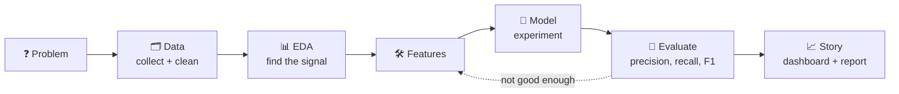

<div align="center">


<br>

<a href="https://github.com/TANISHKA2-TECH?tab=repositories"></a>
<a href="ADD_YOUR_LINKEDIN_URL"></a>
<a href="ADD_YOUR_LEETCODE_URL"></a>
<a href="https://github.com/TANISHKA2-TECH/DefectVision"></a>

</div>

---

## 🖥️ `whoami`

```text
┌──────────────────────── TANISHKA :: PROFILE ────────────────────────┐
│ name        : Tanishka Singh                                        │
│ role        : Aspiring Data Scientist / Data Analyst                │
│ studying    : B.Tech CSE, KIET Group of Institutions (2024-28)      │
│ focus       : computer vision, anomaly detection, data analytics    │
│ currently   : building one-class defect detectors on Kaggle         │
│ toolbox     : Python, SQL, PyTorch, scikit-learn, Tableau           │
│ certified   : AWS Cloud Practitioner, AWS Data Engineer Associate   │
│ side quests : YouTube creator, vocalist, dancer, beatboxer          │
└─────────────────────────────────────────────────────────────────────┘
```

---

## ⚡ Tech Stack

<div align="center">

**Languages and data**


**Machine learning and vision**


**Visualization, cloud and design**


</div>

---

## 🚀 Featured Projects

<table>
<tr>
<td width="50%" valign="top">

### 🔍 [DefectVision](https://github.com/TANISHKA2-TECH/DefectVision)
**One-class industrial defect detection**

Trains on **normal images only**. A PatchCore-style detector fuses WideResNet50, ResNeXt101 and an EfficientNet ensemble, sets thresholds from held-out normals, and uses consensus voting for the final labels.


</td>
<td width="50%" valign="top">

### ♻️ [Smart Waste Collection](https://github.com/TANISHKA2-TECH/SmartWaste_Collection_Management_System)
**IoT-based waste routing system**

Ultrasonic sensors track bin fill-levels, a cloud backend raises alerts and plans optimized collection routes, and citizens can report overflowing bins from a mobile app.


</td>
</tr>
<tr>
<td width="50%" valign="top">

### 📉 Telco Customer Churn Analysis
**Python, SQL, scikit-learn, Tableau**

Cleaned 7,043 customer records, found churn drivers through EDA, compared Logistic Regression and Random Forest on an imbalanced target (about 27% churn), and built a Tableau dashboard with retention recommendations.


</td>
<td width="50%" valign="top">

### 📚 C++ Projects
**[Library Management System](https://github.com/TANISHKA2-TECH/Library-Management-System)** and **[Number Guessing Game](https://github.com/TANISHKA2-TECH/Number-Guessing-Game)**

Core programming practice in C++: structuring a small management application and building an interactive game.


</td>
</tr>
</table>

---

## 🧠 How I Work



I like problems where labels are scarce: anomaly detection, one-class learning and transfer learning. I try to be upfront about what a model actually did and what was tuned on a public split.

---

## 🏆 Certifications

<div align="center">


<br>


</div>

---

## 🎬 Beyond the Code

| 🎥 Creator | 🎤 Stage | 🤝 Community |
|---|---|---|
| Built and run **2 YouTube channels** (English and Hindi) at **13.3K+** and **9.3K+** subscribers | 4th prize, group dance (inter-institute) | Speaker Coordinator, **TEDxKIET** |
| **8.7M+** cumulative views, peak reach of 4.8M | 2nd prize, group singing | Treasurer, **KIET Steppers** dance crew |
| SEO, thumbnails and content packaging | 3rd prize, beatboxing | Vocalist, **KIET Music Club** |
| | 3rd prize, open mic | AR/VR member, **KIET Innogeeks** |

---

## 📌 Currently

- 🔭 Improving small-defect detection with multi-scale features
- 🌱 Learning more cloud data engineering on AWS
- 🤝 Looking for data science and analytics internships
- 💬 Ask me about anomaly detection, PatchCore, Kaggle or Tableau

---

<div align="center">

*"Teach a model what normal looks like, and the rest explains itself."*


</div>
