


 

  

  


  

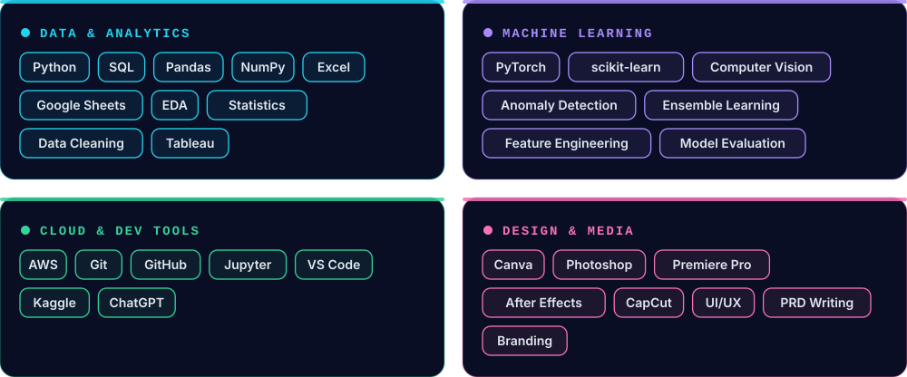

  


<a href="https://github.com/TANISHKA2-TECH/DefectVision"></a>

 

  

<a href="https://github.com/TANISHKA2-TECH/YOUR_CHURN_REPO">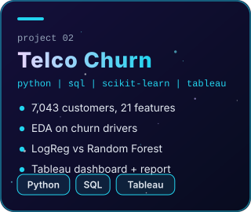</a>
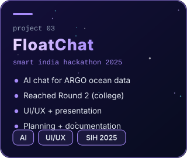
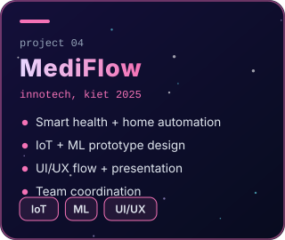

  

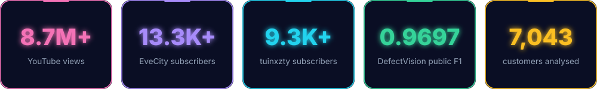

  

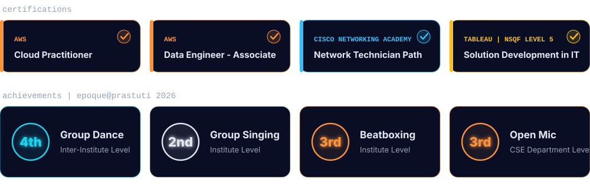

  

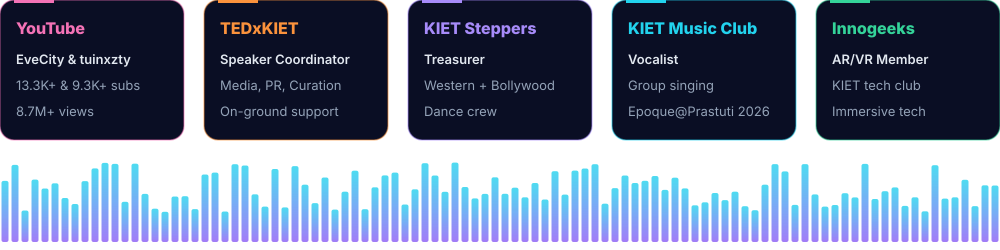

  


  


 

  

